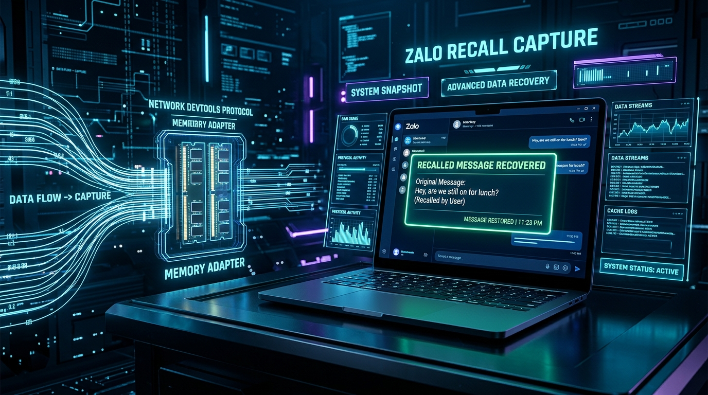
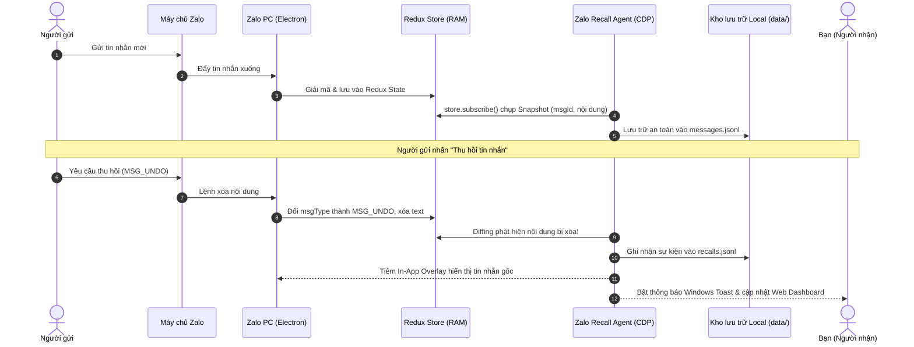

# 🚀 Zalo Recall Capture (CDP)

<div align="center">



**Top 1 Công Cụ Khôi Phục & Bắt Tin Nhắn Thu Hồi Zalo PC Trực Tiếp Từ Bộ Nhớ RAM**  
*Hoạt động thời gian thực qua Chrome DevTools Protocol · 100% Cục bộ & Bảo mật · Không can thiệp file nhị phân*

[](https://microsoft.com/windows)
[](https://nodejs.org)
[](https://chromedevtools.github.io/devtools-protocol/)
[](sanitize.ps1)
[](jxl.mjs)
[](LICENSE)

[Tính năng đột phá](#-tính-năng-đột-phá) • [Tại sao các tool khác thất bại?](#-vì-sao-các-giải-pháp-khác-thất-bại) • [Kiến trúc hoạt động](#-kiến-trúc--nguyên-lý-hoạt-động) • [Hướng dẫn sử dụng](#-hướng-dẫn-sử-dụng) • [Bảo mật dữ liệu](#-bảo-mật--quyền-riêng-tư)

</div>

---

## 🌟 Giới thiệu

Khi bạn nhận được một tin nhắn quan trọng trên Zalo nhưng người gửi vội vàng bấm **"Thu hồi"**, bạn chỉ còn thấy dòng chữ trống rỗng: `[Tin nhắn đã được thu hồi]`.

**Zalo Recall Capture** là giải pháp công nghệ tiên tiến giải quyết triệt để bài toán này. Bằng việc kết nối trực tiếp vào tầng trình diễn (Renderer Engine) của Zalo PC thông qua chuẩn **Chrome DevTools Protocol (CDP)**, công cụ ghi nhận và lưu trữ nguyên vẹn dữ liệu tin nhắn từ **Redux Store ngay trong RAM** trước khi Zalo kịp mã hóa hoặc xóa bỏ!

---

## 🔥 Vì sao các giải pháp khác thất bại?

| Tiêu chí | Đọc file SQLite / Disk | Can thiệp file `app.asar` | Zalo Recall Capture (CDP) |
|---|---|---|---|
| **Mã hóa Database** | ❌ Thất bại: SQLite Zalo mã hóa AES với khóa sinh động trong RAM. | ⚠️ Phức tạp, dễ bị Zalo phát hiện. |  **Thành công**: Đọc trực tiếp dữ liệu đã giải mã trong RAM. |
| **Khi tin nhắn bị thu hồi** | ❌ Mất vĩnh viễn: Zalo cập nhật `msgType → MSG_UNDO` và xóa trắng text. | ⚠️ Thường xuyên văng ứng dụng khi Zalo cập nhật. |  **Bắt trọn 100%**: Snapshot diffing phát hiện ngay lập tức và giữ bản gốc. |
| **Tính toàn vẹn ứng dụng** | ⚠️ Nguy cơ hỏng CSDL Zalo. | ❌ Phá vỡ mã băm SHA-1 / Chữ ký số của file cài đặt. |  **An toàn tuyệt đối**: Không chỉnh sửa bất kỳ byte nào của Zalo PC. |
| **Phục hồi hình ảnh** | ❌ Ảnh thu hồi bị xóa cache trên ổ cứng. | ⚠️ Thiếu bộ giải mã định dạng mới. |  **Khôi phục nguyên bản**: Tự động giải mã cả ảnh nén thế hệ mới **JPEG-XL (`.jxl`)**. |
| **Hiển thị trực quan** | ❌ Chỉ xuất log khó đọc. | ⚠️ Giao diện chắp vá. |  **Song song**: In-App Overlay ngay trong Zalo + Web Dashboard độc lập (`:9333`). |

---

## ✨ Tính năng đột phá

- ⚡ **Hook Redux Store thời gian thực**: Lắng nghe trực tiếp các thay đổi tin nhắn từ `state.conversations.alls[convId].messages[]` của renderer process.
- 🔄 **Thuật toán Diffing chính xác tuyệt đối**: Theo dõi từng `msgId`. Khi phát hiện trạng thái chuyển sang rỗng hoặc thu hồi, lập tức kích hoạt sự kiện đối chiếu snapshot.
- 🖼️ **Phục hồi Media & JPEG-XL (.jxl)**: Tích hợp sẵn `@jsquash/jxl` để giải mã các tệp thumbnail/ảnh chất lượng cao của Zalo sang PNG hiển thị tức thì.
- 🎯 **In-App Overlay tiện lợi**: Tự động tiêm thẻ nội dung phục hồi màu xanh ngọc ngay bên dưới bong bóng chat bị thu hồi trong cửa sổ Zalo.
- 🌐 **Web Dashboard hiện đại (`localhost:9333`)**:
  - Tìm kiếm toàn văn (full-text search) theo nội dung, tên người gửi, thời gian.
  - Bộ lọc tin nhắn thường vs tin nhắn đã thu hồi.
  - Trình duyệt ảnh/video/file đính kèm offline trực quan.
- 🔔 **Thông báo Windows Toast tức thì**: Hiện thông báo góc màn hình ngay khi có tin nhắn bị thu hồi, kèm trích dẫn nội dung gốc.
- 🔒 **Chế độ Zero-Leak & Sanitize 1-Chạm**: Toàn bộ dữ liệu nằm 100% trên máy bạn. Đi kèm script `sanitize.ps1` (`npm run clean`) để xóa sạch chat logs bất kỳ lúc nào.

---

## 🏛️ Kiến trúc & Nguyên lý hoạt động



---

## 📁 Cấu trúc thư mục

```
zalo-recall-capture/
├── assets/
│   └── banner.jpg               # Banner giới thiệu dự án
├── data/
│   ├── .gitkeep
│   ├── messages.example.jsonl   # File mẫu tin nhắn đã chuẩn hóa
│   ├── recalls.example.jsonl    # File mẫu sự kiện thu hồi
│   ├── media/                   # Lưu trữ ảnh/video đã chụp (được ignore)
│   └── _pngcache/               # Cache ảnh đã giải mã từ .jxl (được ignore)
├── autostart.ps1                # Script chạy ngầm tự động cùng Windows
├── capture-agent.mjs            # CDP Client + Web Dashboard Server (:9333)
├── hook.js                      # Mã tiêm vào Zalo: hook Redux, diffing, overlay
├── install-autostart.ps1        # Cài đặt Windows Scheduled Task
├── jxl.mjs                      # Bộ giải mã ảnh JPEG-XL sang PNG
├── lock-data.ps1                # Phân quyền Windows ACL bảo vệ thư mục data/
├── sanitize.ps1                 # Xóa sạch dữ liệu chat & cache cá nhân (1-click)
├── start.ps1                    # Khởi động Zalo debug mode + Agent + Dashboard
├── stop.ps1                     # Tắt chế độ debug, mở lại Zalo bình thường
├── toast.ps1                    # Hiển thị thông báo Windows Toast
├── uninstall-autostart.ps1      # Gỡ bỏ Scheduled Task khởi động cùng Windows
├── .env.example                 # Cấu hình cổng CDP & Viewer mẫu
└── .gitignore                   # Ngăn chặn tuyệt đối commit dữ liệu chat cá nhân
```

---

## 🚀 Hướng dẫn sử dụng

### Yêu cầu hệ thống
- Hệ điều hành: Windows 10 hoặc Windows 11
- Node.js phiên bản `>= 18.0.0`
- Ứng dụng Zalo PC chính thức đã cài đặt

### 1. Tải mã nguồn & Cài đặt
Mở PowerShell tại thư mục làm việc:
```powershell
git clone https://github.com/thanhduykx/zalo-recall-capture.git
cd zalo-recall-capture
npm install
```

### 2. Khởi chạy giám sát
```powershell
powershell -ExecutionPolicy Bypass -File .\start.ps1
```
- Script sẽ tự động đóng Zalo đang mở và khởi động lại với cổng debug CDP (`9222`).
- Trình duyệt tự động mở trang quản trị tại: [http://localhost:9333](http://localhost:9333).
- Cửa sổ Zalo PC hoạt động bình thường, sẵn sàng bắt mọi tin nhắn thu hồi!

### 3. Tắt ứng dụng
- Tại cửa sổ console của Agent, nhấn `Ctrl + C`.
- Chạy lệnh sau để trả Zalo về trạng thái bình thường:
  ```powershell
  powershell -ExecutionPolicy Bypass -File .\stop.ps1
  ```

### 4. Tự động chạy khi mở máy (Tùy chọn)
Nếu muốn công cụ luôn chạy ngầm bảo vệ tin nhắn mà không cần bật thủ công mỗi ngày:
```powershell
powershell -ExecutionPolicy Bypass -File .\install-autostart.ps1
```
*Để gỡ bỏ chế độ tự khởi động:*
```powershell
powershell -ExecutionPolicy Bypass -File .\uninstall-autostart.ps1
```

---

## 🛡️ Bảo mật & Quyền riêng tư

1. **Cam kết 100% Dữ liệu Cục bộ (Local Only)**:
   - Toàn bộ nội dung tin nhắn, hình ảnh và lịch sử thu hồi chỉ được lưu tại thư mục `data/` trên máy tính của bạn.
   - Không có bất kỳ kết nối mạng nào ra máy chủ bên ngoài hay bên thứ ba.
2. **Khóa quyền truy cập Windows (`lock-data.ps1`)**:
   - Sử dụng lệnh `.\lock-data.ps1` để thiết lập danh sách kiểm soát truy cập (ACL) Windows, chỉ cho phép tài khoản đăng nhập hiện tại và SYSTEM được đọc thư mục `data/`.
3. **Dọn sạch dữ liệu cá nhân (`npm run clean`)**:
   - Trước khi chia sẻ mã nguồn hoặc khi muốn làm sạch lịch sử, chỉ cần chạy:
     ```powershell
     npm run clean
     ```
   - Script `sanitize.ps1` sẽ lập tức xóa sạch toàn bộ chat log, file media và bộ nhớ đệm, khôi phục trạng thái hoàn toàn ẩn danh.

---

## ⚖️ Tuyên bố từ chối trách nhiệm (Disclaimer)

- Dự án này được phát triển cho mục đích học tập, nghiên cứu công nghệ Chromium/Electron DevTools Protocol và phục vụ nhu cầu sao lưu dữ liệu cá nhân của chính chủ tài khoản.
- Tác giả không chịu trách nhiệm cho bất kỳ hành vi sử dụng sai mục đích, theo dõi trái phép hoặc vi phạm điều khoản dịch vụ của bên thứ ba. Hãy luôn tôn trọng quyền riêng tư của người khác.

---

<div align="center">
  <sub>Được phát triển với mục tiêu bảo vệ dữ liệu và nâng cao trải nghiệm người dùng số 🇻🇳</sub>
</div>
